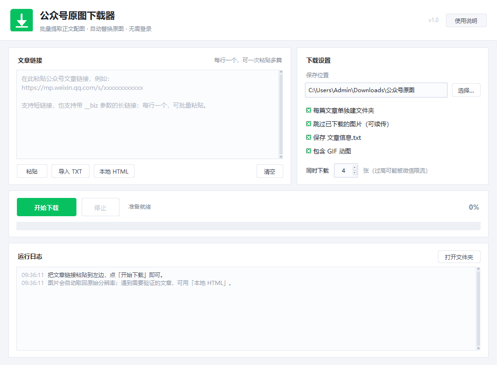

# 公众号原图下载器

> 批量下载微信公众号文章正文配图，自动替换为**原始分辨率**。
> 一个轻量的 Windows 桌面小工具，也可作为命令行脚本使用。



## 为什么需要它

微信文章里的图片是懒加载的，真实地址藏在 `` 中，末尾通常带一个尺寸段：

```
https://mmbiz.qpic.cn/mmbiz_jpg/xxxx/640?wx_fmt=jpeg   ← 网页显示的压缩图（约 1080px）
https://mmbiz.qpic.cn/mmbiz_jpg/xxxx/0?wx_fmt=jpeg     ← 作者上传的原图
```

多数“保存网页”“右键另存”只能拿到压缩版。本工具把尺寸段统一替换为 `0`，
并清掉 `tp=webp`、`wx_lazy` 等参数，再带上 `Referer` 请求，拿回真正的原图。

## 功能

- **批量解析**：一次粘贴多篇文章链接，短链 / 带 `__biz` 的长链都支持
- **原图下载**：`/640` → `/0`，保留 jpg / png / gif / webp 原始格式
- **GIF 动图**：完整保留动画帧
- **断点续传**：已下载的图片自动跳过
- **本地 HTML 兜底**：遇到「环境异常 / 需要验证」的文章，可导入浏览器另存的网页
- **无需登录**：不需要 Cookie、不需要扫码
- **双模式**：图形界面 + 命令行

## 下载

到 [Releases](../../releases) 页面下载：

| 文件 | 说明 |
| --- | --- |
| `公众号原图下载器.exe` | 单文件版，双击即用，首次启动需解压 2–5 秒 |
| `公众号原图下载器_便携版.zip` | 解压后运行，启动更快；单文件版被安全软件拦截时使用 |

也可以直接跑源码：

```bash
pip install requests
python wx_img_downloader.py
```

## 使用

1. 复制公众号文章链接（`https://mp.weixin.qq.com/s/xxxx`）；
2. 粘贴到左侧输入框，每行一个；
3. 选择保存位置，点「开始下载」。

输出结构：

```
公众号原图/
└── 2026-10-30_文章标题/
    ├── 01.jpg
    ├── 02.png
    ├── 03.gif
    └── 文章信息.txt
```

### 命令行

```bash
# 下载多篇
python wx_img_downloader.py --cli "https://mp.weixin.qq.com/s/aaa" "https://mp.weixin.qq.com/s/bbb" -o D:\公众号图片 -j 4

# 从文本文件读取链接（一行一个）
python wx_img_downloader.py --cli -f urls.txt

# 解析浏览器另存下来的网页
python wx_img_downloader.py --cli --html 文章.html
```

| 参数 | 说明 |
| --- | --- |
| `-o, --out` | 保存目录 |
| `-j, --workers` | 图片并发数，1–8，默认 4 |
| `--no-subdir` | 不为每篇文章建文件夹 |
| `--force` | 覆盖已存在的图片（默认跳过） |
| `--no-gif` | 跳过 GIF 动图 |
| `--no-info` | 不生成 `文章信息.txt` |
| `--html` | 解析本地保存的网页，可重复 |
| `--cookie` | 可选，自定义 Cookie |

## 常见问题

**提示「触发微信环境验证」怎么办？**

微信对部分链接（尤其是某些渠道复制的长链接）会要求验证，服务器不返回正文。此时：

1. 用浏览器打开文章，等图片全部加载；
2. `Ctrl + S` 把网页另存为 `.html`；
3. 回到软件点「本地 HTML」，选择刚保存的文件。

**为什么有的图还是不够大？**

微信只保存了作者上传的那一版。如果文章里 `data-w` 本身只有 800，那原图就是 800。
可以打开 `文章信息.txt` 对照原文链接核实。

**下载到一半失败了？**

默认跳过已下载图片，重新点「开始下载」即可续传。失败较多时把「同时下载」调到 2–3。

**exe 被杀毒软件报毒？**

PyInstaller 单文件程序偶尔会被误报。可改用便携版，或直接用源码运行。

## 自己打包

```powershell
pip install pyinstaller
pyinstaller --noconfirm --clean --onefile --windowed --name "公众号原图下载器" --icon icon.ico wx_img_downloader.py
```

或运行 `build_exe.ps1`。

## 项目结构

```
wx_img_downloader.py   # 核心解析、下载、GUI、CLI（单文件）
build_exe.ps1          # 一键打包脚本
requirements.txt       # 运行依赖（requests）
assets/                # 图标与截图
```

## 免责声明

本工具仅用于个人学习、备份已公开的公众号文章配图。
图片版权归原作者及原公众号所有，请勿用于二次传播或商业用途。
